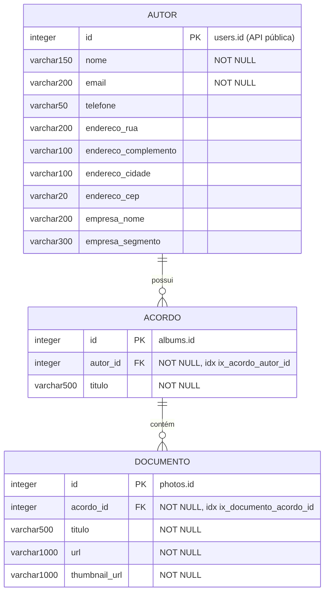
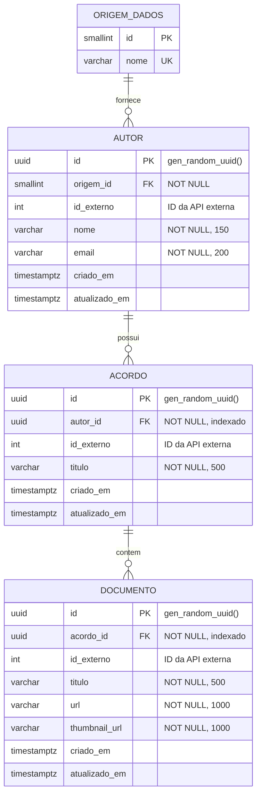

# Case prático: consumo de API, persistência e API de consulta de acordos

Solução em .NET 10 com três entregas encadeadas:

| Parte | O que faz | Projetos |
|---|---|---|
| **Fase 1: Ingestão e persistência** | Um produtor consulta a API pública (jsonplaceholder), publica mensagens em uma fila (SQS, simulado com LocalStack) e um consumidor grava os dados no PostgreSQL com **Surrogate Keys (UUIDs)** de forma idempotente. | `Ingestao`, `Consumidor`, `Mensageria`, `Persistencia`, `Contratos` |
| **Fase 3: API de consulta** | API REST que devolve, a partir do ID do autor, os dados do autor, seus acordos e os documentos de cada acordo. | `CaseAcordos.Api` |
| **Parte 4** | _A preencher (ver [seção própria](#parte-4))._ | — |

Hierarquia respeitada: **Autor → Acordos → Documentos** (`users` → `albums` → `photos` no jsonplaceholder).

## Sumário

1. [Arquitetura](#arquitetura)
2. [Estrutura do repositório](#estrutura-do-repositório)
3. [Como executar](#como-executar)
4. [Modelo de dados (Surrogate Keys & UUIDs)](#modelo-de-dados-surrogate-keys--uuids)
5. [Consultas SQL de Validação](#consultas-sql-de-validação)
6. [API de consulta e Swagger](#api-de-consulta-e-swagger)
7. [Roteiro de demonstração](#roteiro-de-demonstração)
8. [Decisões principais](#decisões-principais)
9. [Configuração](#configuração)
10. [Testes](#testes)
11. [Parte 4](#parte-4)
12. [Próximos passos](#próximos-passos)

---

## Arquitetura


> O arquivo editável é `docs/arquitetura.drawio` (abra em [app.diagrams.net](https://app.diagrams.net/#G19zE0bCLZEJ4YiZV4KVBavEiSch2cZ28F#%7B%22pageId%22%3A%22YS1uaNdUSI1EfS0RRH1M%22%7D). O PNG é a exportação usada aqui.

<details>
<summary>Versão em texto (fluxo da ingestão)</summary>

```
 jsonplaceholder            LocalStack (SQS)                        PostgreSQL
 (API pública)     ┌─────────────────────────────┐
      ▲            │  acordos ──(3 falhas)──► acordos-dlq-consumo
      │ HTTPS      │     ▲                       │
 ┌────┴─────┐      │     │ publica    ┌──────────┴──┐   upsert    ┌─────────┐
 │ Ingestão │──────┼─────┘            │ Consumidor  │────────────►│ autor   │
 │ (produtor)│     │                  └─────────────┘ (1 transação)│ acordo  │
 └────┬─────┘      │  acordos-dlq-ingestao ◄── falha de uma       │documento│
      └────────────┼──────────────────── unidade da carga         └────┬────┘
                                                                       │ SELECT
                                                              ┌────────┴────────┐
                                                              │  API de consulta │◄── cliente (X-Api-Key)
                                                              └─────────────────┘
```

</details>

| Local (este repositório) | AWS (alvo) |
|---|---|
| Worker `CaseAcordos.Ingestao` (disparo manual ou timer de N horas) | EventBridge Scheduler (a cada 3h) + Lambda de Ingestão |
| LocalStack SQS: `acordos`, `acordos-dlq-consumo`, `acordos-dlq-ingestao` | SQS + DLQ de consumo (redrive) + DLQ de ingestão (destino On-Failure do Lambda) |
| Worker `CaseAcordos.Consumidor` | Lambda com trigger SQS (a mesma classe `ProcessadorMensagem`) |
| PostgreSQL no docker-compose | RDS PostgreSQL (Lambdas via RDS Proxy; API em ECS com pool do Npgsql) |
| `CaseAcordos.Api` (Kestrel local) | Container (ECS) |
| Logs JSON no console | Logs JSON enviados ao Datadog |

Para trocar o LocalStack pelo SQS real basta deixar `Filas:UrlServicoSqs` em branco: o código usa a cadeia padrão de credenciais da AWS e resolve a URL das filas por `GetQueueUrl`.

---

## Estrutura do repositório

```
.
├── src/
│   ├── CaseAcordos.Contratos/     # mensagens e modelos compartilhados
│   ├── CaseAcordos.Mensageria/    # publicador/consumidor SQS
│   ├── CaseAcordos.Persistencia/  # upsert (Npgsql + Dapper)
│   ├── CaseAcordos.Ingestao/      # produtor (worker)
│   ├── CaseAcordos.Consumidor/    # consumidor (worker)
│   └── CaseAcordos.Api/           # API de consulta (controllers, DTO, middleware, repositório)
├── tests/CaseAcordos.Testes/      # xUnit (unitários + integração HTTP)
├── db/
│   ├── 01_schema.sql              # tabelas, PKs (UUID), FKs, índices e origens
│   └── 02_consultas.sql           # consultas SQL 
├── docker/                        # Dockerfiles
├── docs/
│   ├── arquitetura.drawio         # diagrama editável
│   ├── arquitetura.png            # exportação do draw.io
│   └── modelagem_de_dados_relacional   # modelagem de dados relacional
├── docker-compose.yml
└── .env.example
```

---

## Como executar

Pré-requisitos: **.NET 10 SDK**, **Docker Desktop** e **Git**. Os comandos funcionam no PowerShell e no bash.

```bash
git clone https://github.com/anabiax/case_acordos.git
cd case_acordos

dotnet build
dotnet test                                            # esperado: todos os testes passando

docker compose up -d                                   # Postgres + LocalStack + filas
docker compose ps                                      # postgres e localstack: healthy
docker compose logs sqs-init                           # lista as 3 filas (sqs-init termina com exited (0): é normal)

dotnet run --project src/CaseAcordos.Consumidor        # terminal 1 (fica rodando)
dotnet run --project src/CaseAcordos.Ingestao          # terminal 2 (executa uma carga e encerra)
dotnet run --project src/CaseAcordos.Api               # terminal 3 (API em http://localhost:5289/swagger/index.html)
```

> **Aviso de recriação de ambiente:** Como a estrutura evoluiu para utilizar `UUID` e `id_externo`, se você tiver dados salvos de versões anteriores do container, limpe os volumes antes de subir: `docker compose down -v && docker compose up -d`.

### Conferir o resultado no banco

```bash
docker compose exec postgres psql -U postgres -d acordos -c "SELECT (SELECT COUNT(*) FROM autor) autores, (SELECT COUNT(*) FROM acordo) acordos, (SELECT COUNT(*) FROM documento) documentos;"
```

Do jsonplaceholder, o esperado é **10 autores, 100 acordos e 5000 documentos**. Rode a ingestão **de novo**: os totais não podem mudar, o que comprova a idempotência.

Para inspecionar visualmente a convivência do **UUID interno** com o **ID externo original**:

```bash
docker compose exec postgres psql -U postgres -d acordos -c "SELECT id AS uuid_interno, id_externo, nome FROM autor LIMIT 5;"
```

---

## Modelo de dados (Surrogate Keys & UUIDs)

O schema está em [`db/01_schema.sql`](db/01_schema.sql) e é aplicado automaticamente pelo Postgres na primeira subida do container.

Evoluímos o schema para utilizar **Chaves Substitutas (Surrogate Keys)** do tipo `UUID` como PKs principais geradas por `gen_random_uuid()`. A identificação oriunda da API externa é isolada nas colunas `id_externo` com restrições `UNIQUE` compostas.





### Como ler o schema (`01_schema.sql`)

| Elemento | Como está no script | Motivo |
|---|---|---|
| **PK = UUID (`gen_random_uuid()`)** | `id UUID PRIMARY KEY` | Desacopla a chave interna dos IDs mutáveis/reutilizáveis da API externa. |
| **Unicidade de Origem** | `CONSTRAINT uq_autor_origem UNIQUE (origem_id, id_externo)` | Suporta a instrução `INSERT ... ON CONFLICT (origem_id, id_externo) DO UPDATE` para idempotência. |
| **FK acordo → autor** | `fk_acordo_autor`: `acordo.autor_id → autor.id` | Garante integridade utilizando os UUIDs internos da aplicação. |
| **FK documento → acordo** | `fk_documento_acordo`: `documento.acordo_id → acordo.id` | Idem. |
| **Índice `ix_acordo_autor`** | `acordo (autor_id)` | Otimiza as buscas `GET /usuarios/{id}/acordos`, agregação por `COUNT` e `JOIN`. |
| **Índice `ix_documento_acordo`** | `documento (acordo_id)` | Atende à paginação dos documentos de um acordo e à busca de consistência `NOT EXISTS`. |
| **Auditoria de Carga** | `criado_em`, `atualizado_em` | Registram rastreabilidade temporal. |

---

## Consultas SQL

Arquivo completo e executável: [`db/02_consultas.sql`](db/02_consultas.sql).

```bash
docker compose exec -T postgres psql -U postgres -d acordos < db/02_consultas.sql
```

| # | Consulta | Para que serve |
|---|---|---|
| 1 | Quantidade de acordos e documentos **por autor** | É o `Resumo` devolvido pela API; exibe `id_externo` e `id_uuid`. |
| 2 | **Ranking** dos autores com maior volume | Identifica concentração de carga com ordenação determinística por `id_externo`. |
| 3 | **Acordos sem documentos** | Detecta falhas de ingestão ou incompletude (`NOT EXISTS`). |
| 4 | **Média de documentos por acordo**, por autor | Valida a distribuição da carga ingerida. |

Exemplo (consulta 1):

```sql
SELECT  au.id_externo              AS autor_id_externo,
        au.id                      AS autor_id_uuid,
        au.nome                    AS autor,
        COUNT(DISTINCT a.id)       AS qtd_acordos,
        COUNT(d.id)                AS qtd_documentos
FROM    autor au
LEFT JOIN acordo    a ON a.autor_id  = au.id
LEFT JOIN documento d ON d.acordo_id = a.id
GROUP BY au.id_externo, au.id, au.nome
ORDER BY au.id_externo;
```

---

## API de consulta e Swagger

Com a API no ar, o Swagger fica acessível localmente em:

**<http://localhost:5289/swagger/index.html>**

O Swagger documenta **4 endpoints**:

| Método | Rota | Autenticação | Descrição |
|---|---|---|---|
| `GET` | `/api/v1/usuarios/{id}/acordos` | API Key | Autor + resumo + acordos paginados por seu `id_externo`. |
| `GET` | `/api/v1/usuarios/{id}/acordos/{acordoId}/documentos` | API Key | Paginação dedicada dos documentos de um acordo. |
| `GET` | `/health` | pública | Readiness: verifica o PostgreSQL (`200` ou `503`). |
| `GET` | `/health/live` | pública | Liveness: indica que a aplicação está ativa. |

**Autenticação:** cabeçalho `X-Api-Key`. No Swagger UI, use o botão **Authorize**.

Exemplo:

```bash
curl -H "X-Api-Key: <sua-chave>" "http://localhost:5289/api/v1/usuarios/1/acordos?paginaDocumentos=1&tamanhoPaginaDocumentos=5"
```

```json
{
  "autor": {
    "id": 1,
    "nome": "Leanne Graham",
    "email": "Sincere@april.biz",
    "telefone": "1-770-736-8031 x56442",
    "endereco": "Kulas Light, Apt. 556 - Gwenborough - CEP 92998-3874",
    "empresa": {
      "nome": "Romaguera-Crona",
      "segmento": "harness real-time e-markets"
    }
  },
  "resumo": {
    "quantidadeAcordos": 10,
    "quantidadeDocumentos": 500
  },
  "acordos": [
    {
      "id": 1,
      "titulo": "quidem molestiae enim",
      "quantidadeDocumentos": 50,
      "documentos": [
        {
          "id": 1,
          "titulo": "accusamus beatae ad facilis cum similique qui sunt",
          "url": "https://picsum.photos/seed/1/600",
          "thumbnailUrl": "https://picsum.photos/seed/1/150"
        }
      ],
      "paginacaoDocumentos": {
        "pagina": 1,
        "tamanhoPagina": 5,
        "totalItens": 50,
        "totalPaginas": 10,
        "possuiProximaPagina": true
      }
    }
  ]
}
```

---

## Roteiro de demonstração

Roteiro para provocar cada cenário durante a apresentação.

### 1. Fluxo feliz e idempotência

```bash
docker compose up -d
dotnet run --project src/CaseAcordos.Consumidor      # terminal 1
dotnet run --project src/CaseAcordos.Ingestao        # terminal 2
```

Confira os totais (10 / 100 / 5000), rode a ingestão **de novo** e confira que os números continuam idênticos.

### 2. Cenários de falha da ingestão

Defina a função auxiliar `aws` no terminal.

PowerShell:
```powershell
function aws { docker run --rm --network case-acordos_default -e AWS_ACCESS_KEY_ID=test -e AWS_SECRET_ACCESS_KEY=test -e AWS_DEFAULT_REGION=us-east-1 amazon/aws-cli --endpoint-url http://localstack:4566 @args }
```
Bash:
```bash
aws() { docker run --rm --network case-acordos_default -e AWS_ACCESS_KEY_ID=test -e AWS_SECRET_ACCESS_KEY=test -e AWS_DEFAULT_REGION=us-east-1 amazon/aws-cli --endpoint-url http://localstack:4566 "$@"; }
```

**a) Mensagem inválida (não retentável) → DLQ de consumo**
```bash
aws sqs send-message --queue-url http://localstack:4566/000000000000/acordos --message-body "isto nao e json"
aws sqs receive-message --queue-url http://localstack:4566/000000000000/acordos-dlq-consumo --message-attribute-names All
```

**b) API pública indisponível → retentativas → DLQ de ingestão**
```bash
JsonPlaceholder__UrlBase=http://localhost:9/ dotnet run --project src/CaseAcordos.Ingestao
```

### 3. Cenários da API de consulta

| Cenário | Comando | Esperado |
|---|---|---|
| Sucesso | `curl -i -H "X-Api-Key: $KEY" http://localhost:5289/api/v1/usuarios/1/acordos` | `200` |
| Sem chave | `curl -i http://localhost:5289/api/v1/usuarios/1/acordos` | `401` |
| Id inválido | `curl -i -H "X-Api-Key: $KEY" http://localhost:5289/api/v1/usuarios/abc/acordos` | `400` |
| Autor inexistente | `curl -i -H "X-Api-Key: $KEY" http://localhost:5289/api/v1/usuarios/99999/acordos` | `404` |

---

## Decisões principais

- **Surrogate Keys (`UUID`) + `id_externo`**: O banco gera `UUID` para assegurar a identidade interna única dos registros. Os IDs da API externa são armazenados em `id_externo` com restrição `UNIQUE`, garantindo idempotência no `UPSERT` e protegendo o domínio interno contra colisões na origem.
- **Transparência na Camada de Apresentação (DTOs)**: A API devolve o `id_externo` numérico nos DTOs de resposta do JSON, respeitando o contrato esperado pelos clientes sem forçar expor UUIDs no consumo externo.
- **Resiliência no UPSERT com Dapper (`RETURNING id`)**: As queries SQL de gravação do repositório retornam o `id` (UUID) gerado ou atualizado. O trecho `DO UPDATE SET` assegura o retorno da linha exigido pelo `.QuerySingleAsync<Guid>()` do Dapper, evitando exceções do tipo `Sequence contains no elements`.
- **1 mensagem por acordo**: Mensagens autocontidas e independentes publicadas na fila SQS.

---

## Configuração

| Chave | Padrão | Descrição |
|---|---|---|
| `JsonPlaceholder:UrlBase` | `https://jsonplaceholder.typicode.com/` | API pública de dados |
| `Filas:UrlServicoSqs` | `http://localhost:4566` em Dev | Endpoint do SQS/LocalStack |
| `ConnectionStrings:Acordos` | (Obrigatória) | Conexão PostgreSQL |
| `Autenticacao:ApiKey` | (Obrigatória) | Chave de segurança consumida via `X-Api-Key` |

---

## Testes

`dotnet test` executa:

- **Unitários (xUnit):** Tradução, de-para, classificação de falhas de retry e regras de validação.
- **Integração HTTP:** Respostas `200`, `400`, `401`, `404`, `503` (tratamento seguro contra vazamento de detalhes) e verificação do middleware `X-Correlation-Id`.

---

## Parte 4

> **Status:** a responder.

---

## Próximos passos

Com a introdução das Surrogate Keys (UUIDs) e do isolamento do `id_externo`, a arquitetura do banco de dados está preparada para evoluções como:
1. Suporte a múltiplas fontes de ingestão via cadastro na tabela `origem_dados`.
2. Habilitação de *Soft Delete* com colunas como `removido_em TIMESTAMPTZ` para marcar registros excluídos na origem.
3. Rastreabilidade de versionamento para garantir o descarte de mensagens antigas reordenadas na fila.