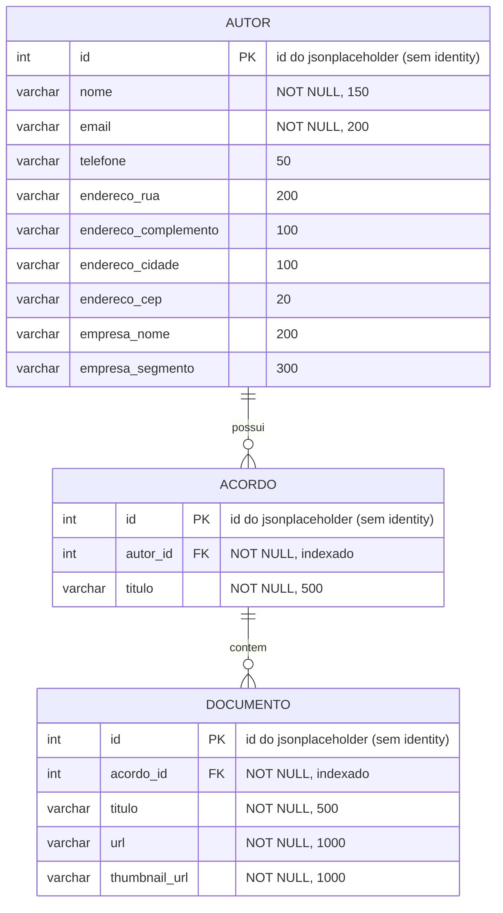

# Case prático: consumo de API, persistência e API de consulta de acordos

Solução em .NET 10 com três entregas encadeadas:

| Parte | O que faz | Projetos |
|---|---|---|
| **Fase 1: Ingestão e persistência** | Um produtor consulta a API pública (jsonplaceholder), publica mensagens em uma fila (SQS, simulado com LocalStack) e um consumidor grava os dados no PostgreSQL, de forma idempotente. | `Ingestao`, `Consumidor`, `Mensageria`, `Persistencia`, `Contratos` |
| **Fase 3: API de consulta** | API REST que devolve, a partir do id do autor, os dados do autor, seus acordos e os documentos de cada acordo. Lê **apenas o banco**, nunca a API pública. | `CaseAcordos.Api` |
| **Parte 4** | _A preencher (ver [seção própria](#parte-4))._ | — |

Hierarquia respeitada: **Autor → Acordos → Documentos** (`users` → `albums` → `photos` no jsonplaceholder).

## Sumário

1. [Arquitetura](#arquitetura)
2. [Estrutura do repositório](#estrutura-do-repositório)
3. [Como executar](#como-executar)
4. [Modelo de dados](#modelo-de-dados)
5. [Consultas SQL](#consultas-sql)
6. [API de consulta e Swagger](#api-de-consulta-e-swagger)
7. [Roteiro de demonstração](#roteiro-de-demonstração)
8. [Decisões principais](#decisões-principais)
9. [Configuração](#configuração)
10. [Testes](#testes)
11. [Parte 4](#parte-4)
12. [Próximos passos](#próximos-passos)

---

## Arquitetura


> O arquivo editável é `docs/arquitetura.drawio` (abra em [app.diagrams.net](https://app.diagrams.net/#G19zE0bCLZEJ4YiZV4KVBavEiSch2cZ28F#%7B%22pageId%22%3A%22YS1uaNdUSI1EfS0RRH1M%22%7D). O PNG é a exportação usada aqui.

<details>
<summary>Versão em texto (fluxo da ingestão)</summary>

```
 jsonplaceholder            LocalStack (SQS)                        PostgreSQL
 (API pública)     ┌─────────────────────────────┐
      ▲            │  acordos ──(3 falhas)──► acordos-dlq-consumo
      │ HTTPS      │     ▲                       │
 ┌────┴─────┐      │     │ publica    ┌──────────┴──┐   upsert    ┌─────────┐
 │ Ingestão │──────┼─────┘            │ Consumidor  │────────────►│ autor   │
 │ (produtor)│     │                  └─────────────┘ (1 transação)│ acordo  │
 └────┬─────┘      │  acordos-dlq-ingestao ◄── falha de uma       │documento│
      └────────────┼──────────────────── unidade da carga         └────┬────┘
                                                                       │ SELECT
                                                              ┌────────┴────────┐
                                                              │  API de consulta │◄── cliente (X-Api-Key)
                                                              └─────────────────┘
```

</details>

| Local (este repositório) | AWS (alvo) |
|---|---|
| Worker `CaseAcordos.Ingestao` (disparo manual ou timer de N horas) | EventBridge Scheduler (a cada 3h) + Lambda de Ingestão |
| LocalStack SQS: `acordos`, `acordos-dlq-consumo`, `acordos-dlq-ingestao` | SQS + DLQ de consumo (redrive) + DLQ de ingestão (destino On-Failure do Lambda) |
| Worker `CaseAcordos.Consumidor` | Lambda com trigger SQS (a mesma classe `ProcessadorMensagem`) |
| PostgreSQL no docker-compose | RDS PostgreSQL (Lambdas via RDS Proxy; API em ECS com pool do Npgsql) |
| `CaseAcordos.Api` (Kestrel local) | Container (ECS) |
| Logs JSON no console | Logs JSON enviados ao Datadog |

Para trocar o LocalStack pelo SQS real basta deixar `Filas:UrlServicoSqs` em branco: o código usa a cadeia padrão de credenciais da AWS e resolve a URL das filas por `GetQueueUrl`.

## Estrutura do repositório

```
.
├── src/
│   ├── CaseAcordos.Contratos/     # mensagens e modelos compartilhados
│   ├── CaseAcordos.Mensageria/    # publicador/consumidor SQS
│   ├── CaseAcordos.Persistencia/  # upsert (Npgsql + Dapper)
│   ├── CaseAcordos.Ingestao/      # produtor (worker)
│   ├── CaseAcordos.Consumidor/    # consumidor (worker)
│   └── CaseAcordos.Api/           # API de consulta (controllers, DTO, middleware, repositório)
├── tests/CaseAcordos.Testes/      # xUnit (unitários + integração HTTP)
├── db/
│   ├── 01_schema.sql              # tabelas, PKs, FKs e índices
│   └── 02_consultas.sql           # consultas SQL relevantes
├── docker/                        # Dockerfiles
├── docs/
│   ├── arquitetura.drawio         # diagrama editável
│   ├── arquitetura.png            # exportação do draw.io
│   └── er-diagrama.png            # diagrama entidade-relacionamento
├── docker-compose.yml
└── .env.example
```

## Como executar

Pré-requisitos: **.NET 10 SDK**, **Docker Desktop** e **Git**. Os comandos funcionam no PowerShell e no bash, salvo onde indicado.

```bash
git clone https://github.com/anabiax/case_acordos.git
cd case_acordos

dotnet build
dotnet test                                            # esperado: todos os testes passando

docker compose up -d                                   # Postgres + LocalStack + filas
docker compose ps                                      # postgres e localstack: healthy
docker compose logs sqs-init                           # lista as 3 filas (sqs-init termina com exited (0): é normal)

dotnet run --project src/CaseAcordos.Consumidor        # terminal 1 (fica rodando)
dotnet run --project src/CaseAcordos.Ingestao          # terminal 2 (executa uma carga e encerra)
dotnet run --project src/CaseAcordos.Api               # terminal 3 (API em http://localhost:5289)
```

- O Postgres aplica `db/01_schema.sql` sozinho na primeira subida.
- Nos logs (JSON) procure `Carga iniciada`, `Acordo publicado`, `Acordo gravado` e `Carga finalizada`, todos com o mesmo `CorrelationId`.
- Para **depurar**, abra a solução no Visual Studio/Rider, defina os projetos desejados como inicialização e coloque breakpoints (por exemplo em `ServicoIngestao.ProcessarAcordoAsync` e `ProcessadorMensagem.ProcessarAsync`).
- **LocalStack:** a tag `latest` passou a exigir conta/token (desde 23/03/2026). O compose fixa `localstack/localstack:4.12` (versão comunitária). Se o container reclamar de token, copie `.env.example` para `.env` e siga as instruções de lá.
- A API exige uma API Key. Defina-a antes de subir (veja [Configuração](#configuração)).

### Conferir o resultado no banco

```bash
docker compose exec postgres psql -U postgres -d acordos -c "select (select count(*) from autor) autores, (select count(*) from acordo) acordos, (select count(*) from documento) documentos;"
```

Do jsonplaceholder, o esperado é **10 autores, 100 acordos e 5000 documentos**. Rode a ingestão **de novo**: os totais não podem mudar, o que comprova a idempotência.

---

## Modelo de dados

O schema está em [`db/01_schema.sql`](db/01_schema.sql) e é aplicado automaticamente pelo Postgres na primeira subida do container.




### Como ler o schema (`01_schema.sql`)

O script tem três `CREATE TABLE IF NOT EXISTS` (re-executável sem erro) e dois `CREATE INDEX IF NOT EXISTS`.

| Elemento | Como está no script | Motivo |
|---|---|---|
| **PK = id da origem** | `pk_autor`, `pk_acordo`, `pk_documento` sobre `id INTEGER NOT NULL`, sem `SERIAL`/identity | permite o `INSERT ... ON CONFLICT (id) DO UPDATE` que torna a carga idempotente; a PK também é indexada, então busca por id é direta |
| **FK acordo → autor** | `fk_acordo_autor`: `acordo.autor_id → autor.id` | impede acordo órfão; por isso autor, acordo e documentos são gravados na mesma transação, nessa ordem |
| **FK documento → acordo** | `fk_documento_acordo`: `documento.acordo_id → acordo.id` | idem |
| **Índice `ix_acordo_autor_id`** | `acordo (autor_id)` | o PostgreSQL **não** cria índice em coluna de FK. Atende "acordos de um autor" (`GET /usuarios/{id}/acordos`), o `COUNT` de acordos e o JOIN das consultas 1, 2 e 4 |
| **Índice `ix_documento_acordo_id`** | `documento (acordo_id)` | atende a paginação de documentos de um acordo, o `COUNT` de documentos e o `NOT EXISTS` da consulta 3 |
| **Endereço em 4 colunas** | `endereco_rua`, `endereco_complemento`, `endereco_cidade`, `endereco_cep` (origem: `address.*`) | dado atômico no banco; a API monta o "endereço completo" na resposta |
| **Empresa em 2 colunas** | `empresa_nome` (`company.name`), `empresa_segmento` (`company.bs`) | a empresa não tem identidade própria neste case, então fica embutida no autor |
| **Quantidades não persistidas** | `qtd_acordos` e `qtd_documentos` não existem como coluna | são sempre derivadas por `COUNT`, evitando dado redundante que poderia divergir |
| **Tamanhos e `NOT NULL`** | `VARCHAR(n)` com limite; obrigatórios: nome, email, título, url, thumbnail | contato, endereço e empresa podem faltar na origem, então são opcionais |

Pontos para comentar na apresentação:

- **Sem `ON DELETE`:** as FKs usam o padrão (`NO ACTION`), ou seja, não se apaga autor com acordos nem acordo com documentos. Combina com uma carga que só insere/atualiza; se um dia houver remoção, é preciso decidir entre cascata e exclusão lógica.
- **Índice composto:** `documento (acordo_id)` já atende à paginação com `LIMIT/OFFSET`. Se a ordenação passar a ser por outra coluna, um índice `(acordo_id, id)` evitaria ordenar em memória.

### ER × schema: conferência

O diagrama é a visão para leitura; o `01_schema.sql` é a fonte da verdade. Use o ER para explicar a cardinalidade e o SQL para mostrar como ela é garantida:

| No diagrama ER | No `01_schema.sql` |
|---|---|
| `AUTOR ||--o{ ACORDO` (1 autor, N acordos) | `fk_acordo_autor` + `ix_acordo_autor_id` |
| `ACORDO ||--o{ DOCUMENTO` (1 acordo, N documentos) | `fk_documento_acordo` + `ix_documento_acordo_id` |
| Atributo `PK` | `pk_autor`, `pk_acordo`, `pk_documento` |
| Colunas de autor | 10 colunas: `id`, `nome`, `email`, `telefone`, 4 de endereço, 2 de empresa |
| Colunas de acordo / documento | 3 (`id`, `autor_id`, `titulo`) / 5 (`id`, `acordo_id`, `titulo`, `url`, `thumbnail_url`) |
| Índices | normalmente **não** aparecem no ER: aponte-os direto no SQL |

Se o seu `er-diagrama.png` mostrar nomes, colunas ou cardinalidades diferentes dessa tabela (por exemplo, empresa como entidade separada ou endereço em uma coluna só), o diagrama está desatualizado em relação ao script.

---

## Consultas SQL

Arquivo completo e executável: [`db/02_consultas.sql`](db/02_consultas.sql).

```bash
docker compose exec -T postgres psql -U postgres -d acordos < db/02_consultas.sql
```

| # | Consulta | Para que serve |
|---|---|---|
| 1 | Quantidade de acordos e documentos **por autor** | é o `Resumo` devolvido pela API; `LEFT JOIN` mantém autor sem acordos com 0 |
| 2 | **Ranking** dos autores com maior volume de acordos | identifica concentração; desempate por documentos e id |
| 3 | **Acordos sem documentos** | detecta falha de ingestão ou dado incompleto na origem (`NOT EXISTS`) |
| 4 | **Média de documentos por acordo**, por autor | valida a distribuição da carga |
| 5 | Totais gerais | conferência rápida de idempotência (rodar antes e depois de repetir a ingestão) |

Exemplo (consulta 1):

```sql
SELECT  au.id AS autor_id, au.nome AS autor,
        COUNT(DISTINCT a.id) AS qtd_acordos,
        COUNT(d.id)          AS qtd_documentos
FROM    autor au
LEFT JOIN acordo    a ON a.autor_id  = au.id
LEFT JOIN documento d ON d.acordo_id = a.id
GROUP BY au.id, au.nome
ORDER BY au.id;
```

> Dois `LEFT JOIN` em cascata repetem o acordo uma vez por documento. Por isso acordos são contados com `COUNT(DISTINCT a.id)`; contar `a.id` sem `DISTINCT` inflaria o resultado.

---

## API de consulta e Swagger

Com a API no ar, o Swagger fica acessível localmente em:

**<http://localhost:5289/swagger/index.html>**

(a raiz `http://localhost:5289/` redireciona para ele). O Swagger documenta **4 endpoints**:

| Método | Rota | Autenticação | Descrição |
|---|---|---|---|
| `GET` | `/api/v1/usuarios/{id}/acordos` | API Key | Autor + resumo + acordos, cada um com uma página dos seus documentos |
| `GET` | `/api/v1/usuarios/{id}/acordos/{acordoId}/documentos` | API Key | Paginação dedicada dos documentos de um acordo |
| `GET` | `/health` | pública | Readiness: verifica o PostgreSQL (`200` ou `503`) |
| `GET` | `/health/live` | pública | Liveness: o processo está de pé, sem consultar dependências |

**Autenticação:** cabeçalho `X-Api-Key`. No Swagger UI, use o botão **Authorize**. Sem a chave correta a resposta é `401`. `/health*`, `/swagger*` e a raiz são públicos.

**Paginação dos documentos:** `paginaDocumentos` (a partir de 1) e `tamanhoPaginaDocumentos` (padrão 20, máximo 100). O resumo e `quantidadeDocumentos` refletem o total, independentemente da página.

**Erros:** sempre no formato `ProblemDetails` (RFC 7807) com `correlationId`; detalhes internos (host, senha, stack) nunca vão na resposta, só no log.

| Status | Quando |
|---|---|
| `400` | id inválido (`abc`, `0`, negativo) ou paginação fora do limite |
| `401` | API Key ausente ou incorreta (com `WWW-Authenticate: ApiKey`) |
| `404` | autor inexistente ou rota inexistente |
| `503` | banco indisponível |
| `500` | erro inesperado (mensagem genérica) |

Exemplo:

```bash
curl -H "X-Api-Key: <sua-chave>" "http://localhost:5289/api/v1/usuarios/1/acordos?paginaDocumentos=1&tamanhoPaginaDocumentos=5"
```

```json
{
  "autor": { "id": 1, "nome": "...", "email": "...", "telefone": "...", "endereco": "...",
             "empresa": { "nome": "...", "segmento": "..." } },
  "resumo": { "quantidadeAcordos": 10, "quantidadeDocumentos": 500 },
  "acordos": [
    { "id": 1, "titulo": "...", "quantidadeDocumentos": 50,
      "documentos": [ { "id": 1, "titulo": "...", "url": "...", "thumbnailUrl": "..." } ],
      "paginacaoDocumentos": { "pagina": 1, "tamanhoPagina": 5, "totalItens": 50,
                               "totalPaginas": 10, "possuiProximaPagina": true } }
  ]
}
```

---

## Roteiro de demonstração

Roteiro para provocar cada cenário durante a apresentação, na ordem sugerida.

### 1. Fluxo feliz e idempotência

```bash
docker compose up -d
dotnet run --project src/CaseAcordos.Consumidor      # terminal 1
dotnet run --project src/CaseAcordos.Ingestao        # terminal 2
```

Confira os totais (10 / 100 / 5000), rode a ingestão **de novo** e confira que não mudaram. Para mostrar o dado já consultável, chame a API (`/api/v1/usuarios/1/acordos`).

### 2. Cenários de falha da ingestão

Defina uma função `aws` (AWS CLI dentro da rede do compose; ajuste `case-acordos_default` se o nome da rede do seu compose for outro).

PowerShell:
```powershell
function aws { docker run --rm --network case-acordos_default -e AWS_ACCESS_KEY_ID=test -e AWS_SECRET_ACCESS_KEY=test -e AWS_DEFAULT_REGION=us-east-1 amazon/aws-cli --endpoint-url http://localstack:4566 @args }
```
bash:
```bash
aws() { docker run --rm --network case-acordos_default -e AWS_ACCESS_KEY_ID=test -e AWS_SECRET_ACCESS_KEY=test -e AWS_DEFAULT_REGION=us-east-1 amazon/aws-cli --endpoint-url http://localstack:4566 "$@"; }
```

**a) Mensagem inválida (não retentável) → DLQ de consumo**
```bash
aws sqs send-message --queue-url http://localstack:4566/000000000000/acordos --message-body "isto nao e json"
aws sqs receive-message --queue-url http://localstack:4566/000000000000/acordos-dlq-consumo --message-attribute-names All
```
O consumidor registra o erro e a mensagem aparece na DLQ com o atributo `MotivoFalha`.

**b) API pública indisponível → retentativas com backoff → DLQ de ingestão**
```powershell
$env:JsonPlaceholder__UrlBase = "http://localhost:9/"; dotnet run --project src/CaseAcordos.Ingestao
```
```bash
JsonPlaceholder__UrlBase=http://localhost:9/ dotnet run --project src/CaseAcordos.Ingestao
```
Nos logs: 3 avisos de retentativa (≈1s, 2s, 4s), depois `Falha na ingestão` com `Etapa=usuarios`; o processo termina com código de saída 1. Veja a falha na `acordos-dlq-ingestao` (`receive-message` como acima). Depois limpe a variável de ambiente.

**c) Erro de negócio da API pública (404) → sem retentativa**
```powershell
$env:JsonPlaceholder__UrlBase = "https://jsonplaceholder.typicode.com/naoexiste/"; dotnet run --project src/CaseAcordos.Ingestao
```
Falha imediata, **sem** avisos de retentativa, e a mensagem na DLQ de ingestão vem com `"retentavel": false`.

**d) Banco indisponível (falha transitória) → reentrega → DLQ de consumo**
```bash
docker compose stop postgres
dotnet run --project src/CaseAcordos.Ingestao        # publica as mensagens normalmente
```
O consumidor loga `Falha retentável` e não apaga as mensagens. A cada ~60s (visibility timeout) elas são reentregues e, no **3º recebimento**, o SQS as move para `acordos-dlq-consumo`. Para voltar ao normal: `docker compose start postgres` e rode a ingestão de novo (idempotente) para reprocessar.

### 3. Cenários da API de consulta

Com a API no ar e uma chave em `$KEY` (PowerShell: `$KEY = "<sua-chave>"`; use `curl.exe` no lugar de `curl`).

| Cenário | Comando | Esperado |
|---|---|---|
| Sucesso | `curl -i -H "X-Api-Key: $KEY" http://localhost:5289/api/v1/usuarios/1/acordos` | `200` com autor, resumo e acordos |
| Paginação | `curl -H "X-Api-Key: $KEY" "http://localhost:5289/api/v1/usuarios/1/acordos/1/documentos?pagina=2&tamanhoPagina=10"` | `200`, `paginacao.pagina = 2` |
| Sem chave | `curl -i http://localhost:5289/api/v1/usuarios/1/acordos` | `401` + `WWW-Authenticate: ApiKey` |
| Chave errada | `curl -i -H "X-Api-Key: errada" http://localhost:5289/api/v1/usuarios/1/acordos` | `401` |
| Id inválido | `curl -i -H "X-Api-Key: $KEY" http://localhost:5289/api/v1/usuarios/abc/acordos` | `400` com `errors` |
| Página fora do limite | `curl -i -H "X-Api-Key: $KEY" "http://localhost:5289/api/v1/usuarios/1/acordos?tamanhoPaginaDocumentos=101"` | `400` |
| Autor inexistente | `curl -i -H "X-Api-Key: $KEY" http://localhost:5289/api/v1/usuarios/99999/acordos` | `404` |
| Correlation ID | `curl -i -H "X-Correlation-Id: demo-123" http://localhost:5289/health/live` | cabeçalho `X-Correlation-Id: demo-123` devolvido e presente nos logs |
| Liveness | `curl -i http://localhost:5289/health/live` | `200`, `status: Healthy` |
| Readiness | `curl -i http://localhost:5289/health` | `200`, verificação `postgres` saudável |

**Banco indisponível na API:**
```bash
docker compose stop postgres
curl -i http://localhost:5289/health/live                                   # 200: o processo segue de pé
curl -i http://localhost:5289/health                                        # 503: readiness reprova
curl -i -H "X-Api-Key: $KEY" http://localhost:5289/api/v1/usuarios/1/acordos   # 503 sem vazar host/senha
docker compose start postgres
```
Este é o contraste liveness × readiness: o orquestrador **não reinicia** a API (liveness `200`), mas **tira do balanceamento** (readiness `503`) até o banco voltar.

---

## Decisões principais

- **1 mensagem por acordo, com o autor embutido.** Cada mensagem é autocontida (autor + acordo + documentos). Não depende da ordem das demais, então a fila padrão basta (não precisa ser FIFO), vários consumidores gravam em paralelo e uma falha afeta um acordo só.
- **Idempotência por upsert.** `INSERT ... ON CONFLICT (id) DO UPDATE ... WHERE (valores atuais) IS DISTINCT FROM (novos)`, usando os ids da API pública como chave. Reentrega da fila e reexecução da carga não duplicam registros, e o `UPDATE` só ocorre se algum valor mudou.
- **Autor, acordo e documentos em uma única transação.** A FK nunca fica pendurada.
- **Tradução na borda.** Só a camada `Integracao` do produtor conhece os nomes do jsonplaceholder (`Tradutor`). Fila, banco e API usam autor/acordo/documento.
- **Retentativa seletiva na chamada à API pública.** Até 3 retentativas com backoff exponencial e jitter (~1s, 2s, 4s), somente para timeout, falha de rede, 5xx, 408 e 429. 400/404 não são repetidos.
- **Duas DLQs com significados diferentes.**
  - `acordos-dlq-ingestao`: cada unidade da carga que falhou (usuários, acordos de um usuário, documentos de um acordo, publicação), com etapa, ids, erro e se era retentável. A carga continua com o restante e o processo termina com código de saída 1.
  - `acordos-dlq-consumo`: mensagens que o consumidor não conseguiu gravar. Falha transitória (banco indisponível): a mensagem volta para a fila e, no 3º recebimento (`maxReceiveCount=3`, visibility timeout de 60s), o SQS a move para a DLQ. Falha não retentável (JSON inválido, dado rejeitado pelo banco): vai direto para a DLQ com o motivo no atributo `MotivoFalha`.
- **CorrelationId.** Gerado a cada carga, vai no corpo e no atributo da mensagem e aparece em todos os logs (produtor e consumidor). Na API, é aceito em `X-Correlation-Id` (se válido), devolvido na resposta e incluído nos erros.
- **Logs estruturados em JSON** (início, fim, quantidade processada e falhas da carga).
- **API em camadas.** Controller → serviço (regra) → repositório (Dapper/Npgsql); DTOs de resposta separados por responsabilidade (`DTO/Autores`, `DTO/Acordos`, `DTO/Documentos`, `DTO/Comum`, `DTO/Saude`).
- **API somente leitura sobre o banco.** A consulta não depende da disponibilidade da API pública.
- **Autenticação simples por API Key fixa.** Comparação em tempo constante (hash SHA-256 + `FixedTimeEquals`); o valor apresentado nunca é logado.
- **Erros padronizados e sem vazamento.** `ProblemDetails` com `correlationId`; falha de banco vira `503` genérico e a exceção vai só para o log.
- **Health checks separados.** `/health/live` não consulta dependências; `/health` (readiness) valida o PostgreSQL.

## Configuração

| Chave | Padrão | Descrição |
|---|---|---|
| `JsonPlaceholder:UrlBase` | `https://jsonplaceholder.typicode.com/` | API pública |
| `Ingestao:GrauParalelismo` | `1` | usuários processados ao mesmo tempo |
| `Ingestao:IntervaloHoras` | `0` | `0` = uma carga e encerra; `3` = repete a cada 3h |
| `Retentativa:Maximo` / `AtrasoBase` / `JitterMaximo` / `TimeoutPorTentativa` | `3` / `1s` / `500ms` / `10s` | política de retry |
| `Filas:UrlServicoSqs` | vazio (AWS) / `http://localhost:4566` em Development | endpoint do LocalStack |
| `Filas:FilaAcordos` / `FilaDlqConsumo` / `FilaDlqIngestao` | `acordos` / `acordos-dlq-consumo` / `acordos-dlq-ingestao` | nomes das filas |
| `Consumidor:GrauParalelismo` | `4` | mensagens do lote gravadas ao mesmo tempo |
| `ConnectionStrings:Acordos` | (obrigatória no consumidor e na API) | conexão com o PostgreSQL |
| `Autenticacao:ApiKey` | (obrigatória na API) | API Key esperada no cabeçalho `X-Api-Key` |

<!-- TODO: confirmar o nome real da seção/variável da API Key (OpcoesAutenticacao.Secao) e o padrão do cabeçalho em OpcoesAutenticacao. -->

Qualquer chave pode ser sobrescrita por variável de ambiente com `__` (ex.: `Filas__UrlServicoSqs`, `Autenticacao__ApiKey`). Não há segredos no código: as credenciais de `appsettings.Development.json` e do compose são valores fictícios de ambiente local. A API valida as opções na subida (fail-fast se faltar a API Key ou a conexão).

## Testes

`dotnet test` executa:

- **Unitários (xUnit):** tradução e de-para, política de retentativa e classificação de falhas, cliente HTTP (503, 429, 404, timeout), serviço de ingestão (carga completa, falhas parciais, DLQ) e processador de mensagens do consumidor (validação, falhas retentáveis e não retentáveis).
- **Integração da camada HTTP da API** (`AcordosApiTests`, com o serviço substituído): `200`, `400`, `401`, `404`, `503` sem vazar detalhes internos, `500` genérico com correlationId, reaproveitamento/substituição do `X-Correlation-Id`, `/health/live` público e documento OpenAPI com os endpoints e o esquema `X-Api-Key`.

---

## Parte 4

<!-- Preencher após receber o enunciado/decisões desta parte. Sugestão de estrutura abaixo. -->

> **Status:** a responder.

- **Enunciado / objetivo:** _a preencher_
- **Abordagem e decisões:** _a preencher_
- **Como executar / validar:** _a preencher_
- **Limitações e trade-offs:** _a preencher_

---

## Próximos passos

### Limitação conhecida: identidade dos autores

Hoje, o `users.id` do jsonplaceholder é persistido diretamente como PK de `autor`, e o upsert usa esse identificador. Isso atende ao contrato deste case e funciona com a fonte de dados fixa utilizada aqui, mas significa que a identidade do autor depende da estabilidade do identificador externo. Se a origem reutilizasse o mesmo ID para outra pessoa, o upsert poderia atualizar o autor existente e associar os dados à identidade errada.

Como evolução para uma integração com uma fonte real, o banco poderia ter uma chave própria para `autor` (por exemplo, um UUID) e armazenar separadamente a origem e o ID externo, com unicidade em `(origem, id_externo)`. Em um cenário corporativo, a identidade deveria ser vinculada ao cadastro mestre da organização, quando disponível. Um serviço de identidade consultado durante a ingestão só seria necessário se essa resolução fosse responsabilidade de outro sistema; ele não elimina o risco de reutilização do ID externo sem uma fonte confiável para confirmar a identidade.

Essa evolução não faz parte deste case. Ela exigiria uma migração do schema e dos dados, além de ajustar o upsert do autor, a resolução da chave interna usada pela FK de `acordo`, as consultas e os testes. O contrato externo poderia continuar usando o ID do jsonplaceholder — por exemplo, em `GET /api/v1/usuarios/{id}/acordos` — desde que a consulta traduzisse esse ID para a chave interna. Portanto, não é uma troca isolada de coluna, mas também não exige necessariamente mudar o contrato da API.
