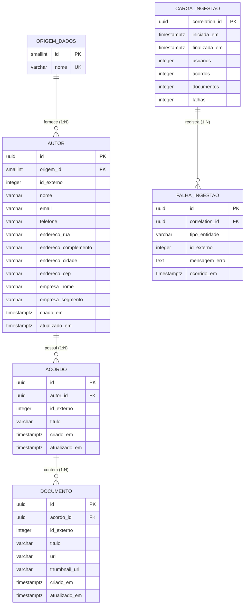

# Modelagem de Dados Relacional (Modelo Evoluído)

Esta documentação descreve a modelagem relacional do banco de dados utilizando **Surrogate Keys (UUID)** como chaves primárias e isolando a identificação externa proveniente da fonte de dados (JSONPlaceholder) em restrições únicas compostas (`origem_id` + `id_externo`).

---

## 1. Diagrama Entidade-Relacionamento (ER)



---

## 2. Detalhamento dos Relacionamentos

### `origem_dados` (1) ───< `autor` (N)
* **Tipo:** 1 para N (Um-para-Muitos).
* **Descrição:** Representa a fonte pagadora/provedora dos dados de autores (ex: `jsonplaceholder`).
* **Chave Estrangeira:** `autor.origem_id` referencia `origem_dados.id`.
* **Regra de Unicidade:** A combinação `(origem_id, id_externo)` na tabela `autor` forma uma chave alternativa única (`UQ`), impedindo duplicidade de autores da mesma origem.

### `autor` (1) ───< `acordo` (N)
* **Tipo:** 1 para N (Um-para-Muitos).
* **Descrição:** Um autor pode ter zero, um ou vários acordos associados.
* **Chave Estrangeira:** `acordo.autor_id` referencia `autor.id` (UUID interno).
* **Integridade Referencial:** `ON DELETE CASCADE` (opcional conforme regra de negócio).
* **Regra de Unicidade:** A combinação `(autor_id, id_externo)` na tabela `acordo` garante que um mesmo acordo externo não seja inserido duas vezes para o mesmo autor.

### `acordo` (1) ───< `documento` (N)
* **Tipo:** 1 para N (Um-para-Muitos).
* **Descrição:** Um acordo contém zero, um ou múltiplos documentos anexos.
* **Chave Estrangeira:** `documento.acordo_id` referencia `acordo.id` (UUID interno).
* **Integridade Referencial:** `ON DELETE CASCADE`.
* **Regra de Unicidade:** A combinação `(acordo_id, id_externo)` na tabela `documento` garante a unicidade dos anexos de cada acordo.

---

## 3. Dicionário de Dados

### Tabela `origem_dados`
| Coluna | Tipo | Nulo | Descrição / Regra |
| :--- | :--- | :---: | :--- |
| `id` | `SMALLINT` | **Não** | **PK** - Identificador numérico interno da origem. |
| `nome` | `VARCHAR(50)` | **Não** | **UNIQUE** - Nome da fonte (ex: `'jsonplaceholder'`). |

### Tabela `autor`
| Coluna | Tipo | Nulo | Descrição / Regra |
| :--- | :--- | :---: | :--- |
| `id` | `UUID` | **Não** | **PK** - Surrogate Key (gerado por `gen_random_uuid()`). |
| `origem_id` | `SMALLINT` | **Não** | **FK** -> `origem_dados(id)`. |
| `id_externo` | `INTEGER` | **Não** | ID do autor recebido na API/Payload. |
| `nome` | `VARCHAR(150)` | **Não** | Nome do autor. |
| `email` | `VARCHAR(200)` | **Não** | E-mail de contato do autor. |
| `telefone` | `VARCHAR(50)` | Sim | Telefone principal. |
| `endereco_rua` | `VARCHAR(200)` | Sim | Logradouro / Rua. |
| `endereco_complemento` | `VARCHAR(100)` | Sim | Complemento / Ap / Bloco. |
| `endereco_cidade` | `VARCHAR(100)` | Sim | Cidade. |
| `endereco_cep` | `VARCHAR(20)` | Sim | Código Postal / CEP. |
| `empresa_nome` | `VARCHAR(200)` | Sim | Nome da empresa associada. |
| `empresa_segmento` | `VARCHAR(300)` | Sim | Ramos de atividade / Segmento. |
| `criado_em` | `TIMESTAMPTZ` | **Não** | Timestamp da inserção no banco (`DEFAULT now()`). |
| `atualizado_em` | `TIMESTAMPTZ` | **Não** | Timestamp da última atualização (`DEFAULT now()`). |
* **Constraint:** `CONSTRAINT uq_autor_origem UNIQUE (origem_id, id_externo)`

### Tabela `acordo`
| Coluna | Tipo | Nulo | Descrição / Regra |
| :--- | :--- | :---: | :--- |
| `id` | `UUID` | **Não** | **PK** - Surrogate Key interna. |
| `autor_id` | `UUID` | **Não** | **FK** -> `autor(id)`. |
| `id_externo` | `INTEGER` | **Não** | ID do acordo/álbum vindo da fonte. |
| `titulo` | `VARCHAR(500)` | **Não** | Título do acordo. |
| `criado_em` | `TIMESTAMPTZ` | **Não** | Timestamp da criação. |
| `atualizado_em` | `TIMESTAMPTZ` | **Não** | Timestamp da atualização. |
* **Constraint:** `CONSTRAINT uq_acordo_externo UNIQUE (autor_id, id_externo)`
* **Índice:** `ix_acordo_autor` na coluna `autor_id`.

### Tabela `documento`
| Coluna | Tipo | Nulo | Descrição / Regra |
| :--- | :--- | :---: | :--- |
| `id` | `UUID` | **Não** | **PK** - Surrogate Key interna. |
| `acordo_id` | `UUID` | **Não** | **FK** -> `acordo(id)`. |
| `id_externo` | `INTEGER` | **Não** | ID da foto/documento vindo da fonte. |
| `titulo` | `VARCHAR(500)` | **Não** | Título/Descrição do documento. |
| `url` | `VARCHAR(1000)` | **Não** | Link de acesso ao documento. |
| `thumbnail_url` | `VARCHAR(1000)` | **Não** | Link da imagem em miniatura. |
| `criado_em` | `TIMESTAMPTZ` | **Não** | Timestamp de criação. |
| `atualizado_em` | `TIMESTAMPTZ` | **Não** | Timestamp de atualização. |
* **Constraint:** `CONSTRAINT uq_documento_externo UNIQUE (acordo_id, id_externo)`
* **Índice:** `ix_documento_acordo` na coluna `acordo_id`.

---

## 4. Estratégia de Ingestão e Idempotência (`UPSERT`)

A idempotência das mensagens ingeridas é garantida via PostgreSQL usando `ON CONFLICT` com a cláusula `IS DISTINCT FROM`. Isso garante que:
1. Reprocessar a mesma mensagem não causa erros de violação de chave primária.
2. Atualizações só alteram registros no disco e modificam o `atualizado_em` caso **algum dado real tenha mudado**, evitando concorrência desnecessária em locks de tabelas.

```sql
-- Exemplo para a tabela Autor:
INSERT INTO autor (origem_id, id_externo, nome, email, ...)
VALUES (@OrigemId, @IdExterno, @Nome, @Email, ...)
ON CONFLICT (origem_id, id_externo) DO UPDATE SET
    nome = EXCLUDED.nome,
    email = EXCLUDED.email,
    atualizado_em = now()
WHERE (autor.nome, autor.email) IS DISTINCT FROM (EXCLUDED.nome, EXCLUDED.email)
RETURNING id;
```